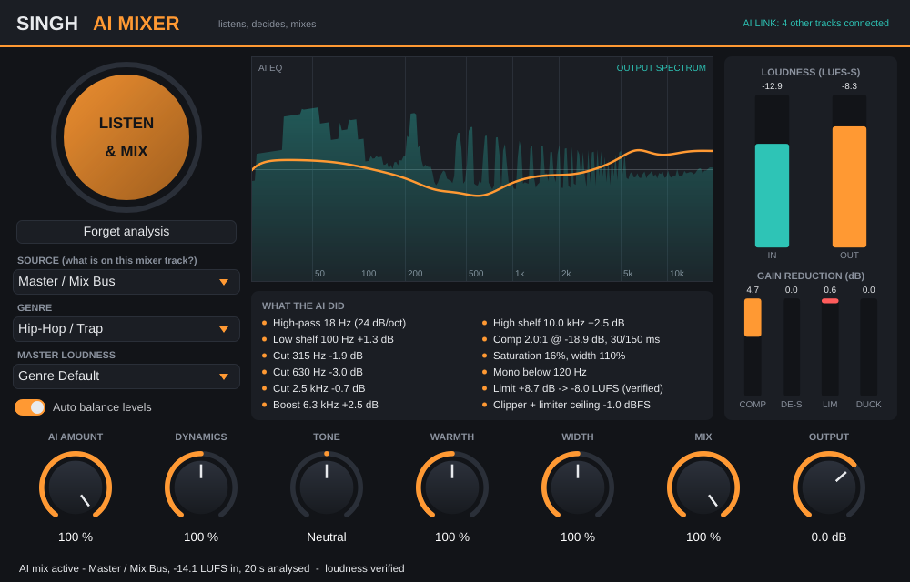

# Singh AI Mixer

An AI mixing assistant plugin for **FL Studio** (VST3 on Windows/macOS, plus AU and Standalone).
Put it on your mixer tracks, press **LISTEN & MIX**, play the song, and it does what a mix engineer
would do first on every track. It works out what the source is, measures its tone, dynamics, loudness and stereo
image, then sets up gain staging, EQ, de-essing, compression, saturation, stereo width, kick/bass
ducking and master loudness.



## What it does

| Stage | What the AI decides |
|---|---|
| **Source detection** | Classifies the track (kick, 808, bass, lead vocal, hats, snare, pad, keys, full mix…) from its spectrum, crest factor and stereo image. You can also pick the source yourself. |
| **Gain staging / balance** | Sets each track to the level an engineer would typically give it in the chosen genre (e.g. lead vocal ≈ −16 LUFS, pads ≈ −25 LUFS). |
| **High-pass** | 24 dB/oct, placed just below where the source's real content starts. |
| **Corrective + tonal EQ** | Compares the track's long-term spectrum with a target curve for that source and genre, then applies up to 6 broad, musical bands (cuts up to −6 dB, boosts up to +4 dB, gentler on the master). |
| **Resonance removal** | Finds narrow ringing peaks (boxy kicks, honky vocals, room modes) and notches them. |
| **De-esser** | Split-band and level-independent, tuned to the singer's sibilance frequency. |
| **Compression** | Ratio, attack and release follow the source type. The threshold comes from the measured level, so the compressor does a consistent amount of work. Parallel compression is used on the drum bus. |
| **Saturation** | Soft analog-style harmonics, referenced to the track's own peak level. |
| **Stereo** | Width per source; low end is kept mono (below 120–250 Hz). |
| **AI Link** | Instances talk to each other: **808/bass duck under the kick**, and keys/pads/guitars open a **dynamic pocket for the lead vocal** only while the singer is singing. |
| **Master** | Gentle tonal-balance EQ, glue compression, soft clipper + look-ahead limiter driven to the genre's loudness target (or −14/−11/−9/−7 LUFS), ceiling −1 dBFS. |
| **Loudness verification** | After listening, the plugin renders its own chain over the audio it heard, measures the real LUFS, and corrects the gain until it hits the target. The UI then shows *"(verified)"*. |

Genres: Hip-Hop/Trap, Pop, EDM, Rock, R&B, Lo-Fi, Punjabi/Bhangra, Acoustic. Each genre changes the target tone
curves, compression and saturation amounts, balance and master loudness.

### Macro knobs (all automatable)

* **AI Amount**: how much of the AI's processing to apply (0 % = untouched).
* **Dynamics**: less or more compression than the AI chose.
* **Tone**: dark ↔ bright tilt.
* **Warmth**: saturation amount.
* **Width**: stereo width.
* **Mix**: dry/wet, latency-compensated, for parallel processing of everything.
* **Output**: final gain.

The panel under the analyser lists **what the AI did** in plain words ("Cut 315 Hz −3.1 dB", "Comp 4:1 @ −22 dB",
"Ducks 5 dB under linked kick"…). The meters show loudness in/out and gain reduction for the compressor,
de-esser, limiter and ducking.

## Install

### Download a build

Every push builds the plugin on GitHub Actions. Open the **Actions** tab → latest **Build** run →
*Artifacts*, and download `SinghAIMixer-Windows-VST3` or `SinghAIMixer-macOS-VST3-AU`.
(Pushing a tag like `v1.0.0` also publishes them as a GitHub Release.)

* **Windows:** copy `Singh AI Mixer.vst3` to `C:\Program Files\Common Files\VST3\`
* **macOS:** copy `Singh AI Mixer.vst3` to `~/Library/Audio/Plug-Ins/VST3/` (and the `.component` to
  `~/Library/Audio/Plug-Ins/Components/`). The build is not code-signed. If macOS blocks it, run
  `xattr -dr com.apple.quarantine ~/Library/Audio/Plug-Ins/VST3/Singh\ AI\ Mixer.vst3`

Then in FL Studio: **Options → Manage plugins → Find installed plugins**, and star *Singh AI Mixer*.

### Build it yourself

You need CMake ≥ 3.22 and a C++17 compiler (Visual Studio 2022 on Windows, Xcode on macOS). JUCE is
downloaded automatically.

```bash
cmake -S . -B build -DCMAKE_BUILD_TYPE=Release
cmake --build build --config Release --target SinghAIMixer_VST3
# result: build/SinghAIMixer_artefacts/Release/VST3/Singh AI Mixer.vst3
```

## How to mix a song in FL Studio

1. **Route every instrument to its own mixer insert** (kick, snare, hats, 808, vocals, keys…).
2. **Put Singh AI Mixer on each insert.** Choose the **Source** (or leave *Auto Detect*) and the same
   **Genre** on all of them.
3. **Press LISTEN & MIX on every track**, then press play on the busiest part of the song (chorus/drop).
   All instances listen at the same time. Each one finishes by itself after 20 s of audio, or press
   *Mix now* to finish early.
4. **Then do the master.** Put Singh AI Mixer on the **Master** insert, set Source to *Master / Mix Bus*,
   pick a **Master Loudness**, press LISTEN & MIX and play the chorus again. The master listens to the already-mixed tracks, so
   it should go last.
5. Use your ears. Turn **AI Amount** down on anything that feels over-processed, use **Tone / Dynamics /
   Width** to taste, and ride the faders. Changing *Source* or *Genre* re-mixes instantly from the stored
   analysis without listening again.

**Tips**

* AI Link only works for instances in the same process. In FL Studio's plugin wrapper, keep
  *"Make bridged"* and *"Use separate process"* **off** for this plugin. The header shows how many tracks are linked.
* The analysis is saved with your project, so you don't have to listen again after reopening it.
* The plugin adds 5 ms of latency (the master limiter's look-ahead). FL Studio compensates for it automatically.

## How the "AI" works

The plugin uses no cloud service and no neural network. Everything runs locally and in real time:

* **Ears** (`Source/dsp/Analyzer.*`): 4096-point FFT long-term spectrum (1/3-octave and fine resolution),
  ITU-R BS.1770 gated loudness, level histogram, crest factor, L/R correlation, low-end side energy,
  sibilance and resonance detection, and a source classifier.
* **Brain** (`Source/dsp/MixEngine.*`): an engineering knowledge base per source (target tone curve,
  useful range, compression style, balance level, width) and per genre. It turns measurements into concrete
  settings, then **renders the chain offline and corrects loudness** until it hits the target.
* **Hands** (`Source/dsp/ChannelStrip.*`): the real-time processing chain: trim → HPF/LPF → 8-band EQ +
  tone tilt + dynamic vocal pocket → de-esser → RMS compressor → saturation → kick ducking → M/S width +
  mono bass → soft clipper + look-ahead limiter (master) → output → latency-compensated dry/wet.
* **Link** (`Source/dsp/LinkBus.h`): a lock-free, process-wide bus through which instances share the kick envelope
  and the lead vocal's activity and presence frequency.

**Limits:** it is a very fast, well-informed starting point, not a replacement for your ears. It can't
fix a bad recording or arrangement. Creative choices (reverb, delay, automation, effects) are still yours.

## Development

```bash
# DSP unit tests (no JUCE needed)
cmake -S . -B build-tests -DSAM_BUILD_PLUGIN=OFF && cmake --build build-tests && ctest --test-dir build-tests
```

The tests cover filter maths, BS.1770 loudness calibration, the classifier, EQ decisions, track balance and
master loudness calibration (it hits a −7 LUFS club target at a −1 dBFS ceiling), limiter overshoot, transparency at 0 % Amount,
latency-aligned dry/wet, kick ducking and state serialisation. CI also runs **pluginval** at strictness
level 10 on the Linux build.
